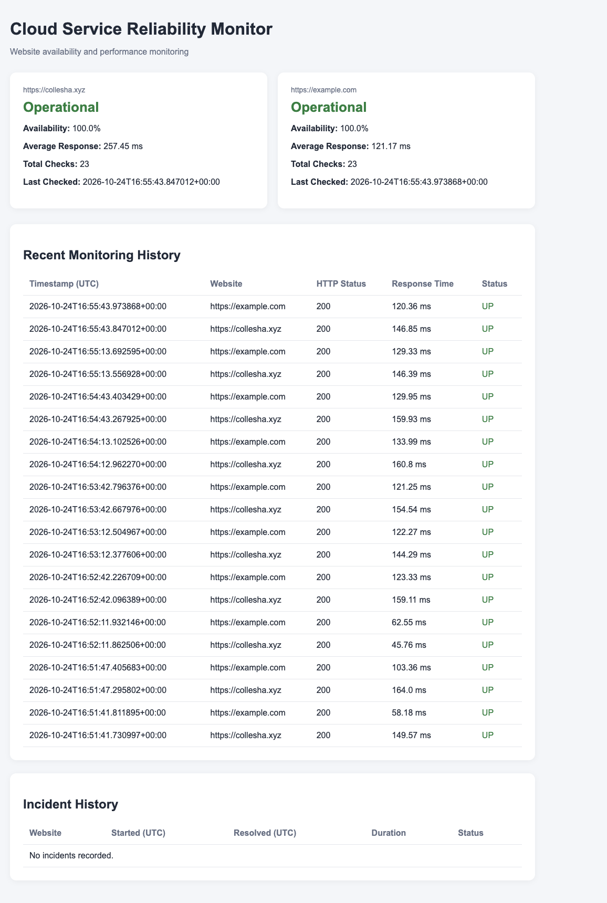
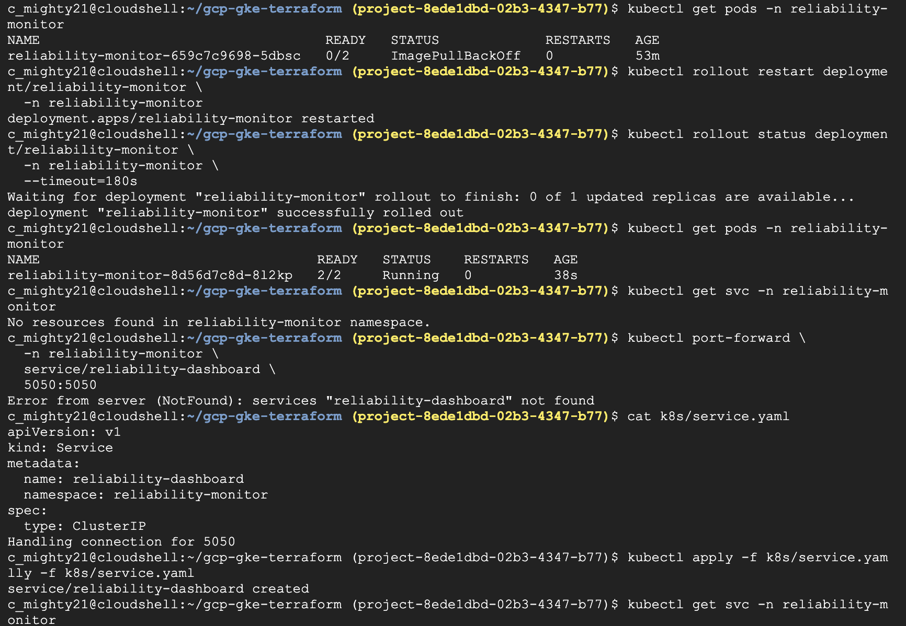

# Cloud Service Reliability Monitor

A containerized website monitoring application deployed on **Google Kubernetes Engine (GKE)** using **Terraform, Docker, Kubernetes, and Python**.

The application monitors website availability, measures response times, detects outages, and displays real-time monitoring results through a Flask dashboard.

This project demonstrates infrastructure as code (IaC), container orchestration, persistent storage, cloud IAM, automated testing, and Kubernetes self-healing.

## Tech Stack

| Category | Technologies |
|---|---|
| Cloud Infrastructure | Google Cloud Platform (GCP), GKE |
| Infrastructure as Code | Terraform |
| Containers & Orchestration | Docker, Docker Compose, Kubernetes |
| Backend | Python 3.12, Flask, Gunicorn |
| Database | SQLite |
| Container Registry | Google Artifact Registry |
| CI | GitHub Actions |
| Tools | Git, Linux, Google Cloud CLI, kubectl |

## Monitoring Dashboard

The dashboard displays website availability, average response times, recent HTTP checks, and incident history.



*Dashboard displaying monitoring results for two websites, with 23 recorded checks per website.*

## Architecture

```text
                         GitHub Repository
                                |
                                v
                       GitHub Actions CI
                     (Unit Tests + Docker Build)


                       Terraform (IaC)
                              |
                              v
                    Google Cloud Platform
                              |
                  Google Kubernetes Engine
                              |
                   Kubernetes Deployment
                              |
                +---------------------------+
                |       Application Pod     |
                |                           |
 Websites <---- |  Python Uptime Monitor    |
                |            |              |
                |            v              |
                |     SQLite Database       |
                |            ^              |
                |            |              |
                |     Flask Dashboard       |
                +---------------------------+
                              |
                   PersistentVolumeClaim
                              |
                    Persistent Storage

Browser --> kubectl port-forward --> Kubernetes Service --> Flask Dashboard

Google Artifact Registry --> Container Image --> GKE Worker Node
```

Terraform provisions the GKE cluster and node pool. The application runs in a Kubernetes Pod containing two containers: the Python monitoring service and Flask dashboard.

Both containers share a persistent volume for SQLite data. Google Artifact Registry stores the Docker image used by Kubernetes.

## Key Features

- **Availability Monitoring:** Performs HTTP checks against configurable websites and records response times, status codes, and errors.
- **Incident Detection:** Automatically records outages and calculates incident duration when services recover.
- **Monitoring Dashboard:** Displays availability percentages, recent checks, response times, and incident history.
- **Persistent Storage:** Uses a Kubernetes PersistentVolumeClaim to preserve monitoring data across Pod replacement.
- **Kubernetes Self-Healing:** Automatically replaces failed or deleted application Pods through a Kubernetes Deployment.
- **Automated Testing:** Uses GitHub Actions to run Python unit tests and validate Docker image builds.

## Deployment & Infrastructure

The application was deployed to a Terraform-provisioned GKE cluster with a dedicated `e2-medium` node pool.

The deployment process included:

1. Provisioning GKE infrastructure using Terraform.
2. Building and publishing the Docker image to Google Artifact Registry.
3. Deploying the application using Kubernetes manifests.
4. Configuring persistent storage for SQLite.
5. Exposing the dashboard through a Kubernetes Service.
6. Verifying application health and monitoring functionality.

Kubernetes configuration files are available in the [`k8s/`](k8s/) directory.

### IAM Troubleshooting

The initial GKE deployment encountered an `ImagePullBackOff` error because the worker node lacked permission to download the image from Artifact Registry.

I resolved this by granting the node service account the `roles/artifactregistry.reader` role on the specific Artifact Registry repository.

After restarting the Deployment, Kubernetes successfully rolled out the application with **2/2 containers running**.



*Troubleshooting the image-pull failure and verifying the successful Kubernetes rollout.*

## Reliability & Testing

### Kubernetes Self-Healing and Data Persistence

To test application recovery, I manually deleted a running Kubernetes Pod.

Kubernetes automatically created a replacement Pod, and both application containers returned to the `Running` state.

The SQLite database remained accessible through the PersistentVolumeClaim, preserving previously recorded monitoring history.

Monitoring checks increased from 8 to 23 per website during testing, demonstrating continued data collection and historical data retention.

### Automated Testing

The project includes **8 passing Python unit tests** covering:

- Successful and failed website checks
- Incident creation and recovery
- Dashboard availability states
- Stale monitoring data detection

GitHub Actions automatically runs the unit tests and builds the Docker image on pushes to `feature/uptime-monitor` and pull requests targeting `main`.

The workflow provides continuous integration; GKE deployment is performed separately.

## Run Locally

**Requirements:** Docker and Docker Compose.

Clone the repository:

```bash
git clone https://github.com/Collesha/gcp-gke-terraform.git
cd gcp-gke-terraform
```

Start the application:

```bash
docker compose up --build
```

Open the dashboard:

**http://localhost:5050**

Stop the application:

```bash
docker compose down
```

Docker Compose uses persistent storage so monitoring history can survive container restarts.

### Configuration

| Environment Variable | Description | Default |
|---|---|---|
| `MONITOR_URLS` | Comma-separated websites to monitor | `https://collesha.xyz,https://example.com` |
| `CHECK_INTERVAL` | Monitoring interval in seconds | `60` |
| `DB_PATH` | SQLite database path | `uptime.db` |

Run the unit tests:

```bash
python -m unittest discover -s tests -v
```

## Project Structure

```text
gcp-gke-terraform/
├── .github/workflows/
│   └── ci.yml
├── app/
│   ├── monitor.py
│   ├── dashboard.py
│   └── requirements.txt
├── docs/screenshots/
│   ├── initial-dashboard.png
│   ├── monitoring-history.png
│   ├── persistent-storage-test.png
│   └── kubernetes-troubleshooting.png
├── k8s/
│   ├── deployment.yaml
│   ├── namespace.yaml
│   ├── pvc.yaml
│   └── service.yaml
├── tests/
│   ├── test_monitor.py
│   └── test_dashboard.py
├── Dockerfile
├── compose.yaml
├── main.tf
└── README.md
```

## Lessons Learned

This project strengthened my experience with:

- **Infrastructure as Code:** Provisioning and destroying GCP infrastructure using Terraform.
- **Kubernetes:** Managing Deployments, Services, Pods, and persistent volumes.
- **Cloud IAM:** Troubleshooting image-pull failures and configuring repository-scoped permissions.
- **Reliability Engineering:** Testing automatic Pod recovery and persistent application data.
- **CI:** Automating application tests and Docker builds through GitHub Actions.

## Project Status

**Completed: October 2026**

The application was successfully deployed and tested on GKE. Cloud infrastructure was subsequently destroyed using Terraform to avoid unnecessary ongoing charges.

The repository retains the application code, infrastructure configuration, Kubernetes manifests, and deployment screenshots for demonstration and future development.